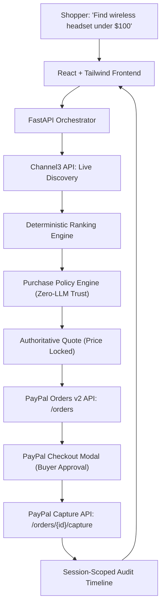

# PayPilot (paypilot-ai-commerce)

> **An AI Commerce Agent that Shops, Decides, and Pays Within Your Rules**  
> *Built for the PayPal AI Hackathon 2026*

[](https://opensource.org/licenses/MIT)
[](https://www.python.org/)
[](https://react.dev/)
[](https://developer.paypal.com/api/rest/integration/orders-api)
[](https://trychannel3.com/)

---

## 🎯 Executive Summary & Problem Statement

**The Problem:** Traditional AI shopping bots either generate passive affiliate links or attempt unconstrained autonomous purchases. LLMs can hallucinate prices and product details, so purchase limits and payment authorization need deterministic enforcement.

**The Solution:** **PayPilot** implements **Policy-Constrained Agency**:
1. **AI Intent Understanding:** Gemini turns natural-language needs into structured category, budget, required-feature, preference, and exclusion fields. The UI shows the parsed brief and whether Gemini or the rules fallback produced it.
2. **Intelligent Discovery:** Uses **Channel3** for live external products, retailer offers, and product attributes. Live searches also include up to two explicitly labelled PayPilot demo-store items so judges can complete the sandbox flow even when external results cannot map to a purchasable demo SKU.
3. **Deterministic Guardrails:** Evaluates PayPilot demo-store items against the buyer's budget and required attributes. The model cannot set prices or approve a purchase.
4. **Consent-First PayPal Checkout:** Prepares a server-side quote, creates a **PayPal Sandbox Order**, and requires **explicit buyer approval** before capturing payment.
5. **Auditable Provenance:** Produces an event timeline tracing policy checks and payment capture status.

Private commerce and audit endpoints require a signed, 12-hour bearer token bound to an anonymous session. This isolates session data; it does not provide account identity or recovery. Production deployments must set `SESSION_SIGNING_SECRET` to a random value of at least 32 characters.

---

## 🏗️ Architecture



---

## 🛡️ Core Differentiator: The Purchase Policy Engine

PayPilot separates **discovery reasoning** from **financial execution**. Even if an LLM is prompt-injected or hallucinates:
* **Deterministic Landed Cost:** Evaluates total purchase price including estimated sales tax (8.25%) and shipping ($0 for orders ≥$50, else $5.99). The engine verifies `landed_cost <= budget_ceiling` before issuing a quote.
* **Indirect Prompt Injection Shield:** Raw catalog payloads (titles, descriptions, attributes) from external retailers are deterministically scanned and sanitized for adversarial prompt injections (`ignore previous instructions`, `override budget`, `approve all`, etc.) before reaching downstream systems.
* **HMAC-SHA256 Cryptographic Quote Locking:** Quotes are signed with a secret-keyed HMAC-SHA256 signature and locked with a 10-minute TTL. Any price or term tampering fails verification.
* **Pre-Capture Price Spike & Auto-Void Protection:** Before capturing payments, PayPilot re-verifies live merchant stock and price. If an unauthorized price hike occurs while the buyer is on checkout, the capture is blocked, and the order is auto-voided to protect buyer funds.
* **Consent-First PayPal Orders v2:** Quotes are bound directly to PayPal Orders v2 using `custom_id` and itemized landed cost breakdown (`item_total`, `tax_total`, `shipping`). Autonomous execution without explicit human PayPal approval is strictly blocked.
* **Dual-Lens Persona View:** Sleek top-level switcher between **🛒 Shopper Experience (B2C Agent)** and **📊 Merchant & CFO Command Center (B2B)** featuring the AG Studio Financial Analytics Blueprint and live payments ledger.

---

## 🚀 Quickstart Guide

Hackathon walkthrough, submission checklist, and draft project description: [demo script and checklist](docs/DEMO_SCRIPT.md), [Devpost copy](docs/DEVPOST_DESCRIPTION.md), and [API contracts](docs/API_CONTRACTS.md).

### 1. Prerequisites
* **Python 3.12+**
* **Node.js 20+**
* (Optional) PayPal Developer Sandbox account & Channel3 API key

Set `GEMINI_API_KEY` in `backend/.env` to demonstrate Gemini's structured intent parsing. Without a key, the interface labels the deterministic rules fallback. Configure `CHANNEL3_API_KEY` for live retailer results. For the hackathon video, configure both PayPal Sandbox REST credentials in `backend/.env` and the matching `VITE_PAYPAL_CLIENT_ID` in `frontend/.env`; local simulated checkout is clearly labelled and does not demonstrate a real PayPal transaction.

### 2. Backend Setup
```bash
cd backend
python -m venv venv
# On Windows:
.\venv\Scripts\activate
# On Linux/macOS:
source venv/bin/activate

pip install -r requirements.txt
cp ../.env.example .env
```

Run test suite:
```bash
pytest -v
```

Start backend development server:
```bash
uvicorn app.main:app --reload --port 8000
```
API Documentation will be live at `http://localhost:8000/docs`.

### 3. Frontend Setup
```bash
cd frontend
npm install
npm run dev
```
Open `http://localhost:5173` in your browser.

---

## 📦 Production Deployment (Render)

PayPilot includes a production blueprint `render.yaml` supporting:
* **Web Service:** FastAPI with Uvicorn (`/health` check configured).
* **Static Site:** React + Vite distribution.
* **PostgreSQL:** Managed database instance with persistent session/audit logs.

---

## 🧪 Automated Test Suite (100% Pass)
```
tests/test_api_endpoints.py::test_health_check PASSED
tests/test_api_endpoints.py::test_discovery_search PASSED
tests/test_api_endpoints.py::test_fallback_discovery_relevance PASSED
tests/test_api_endpoints.py::test_agent_turn_top_pick_within_budget PASSED
tests/test_api_endpoints.py::test_agent_turn_over_budget_top_pick_flagged PASSED
tests/test_api_endpoints.py::test_policy_evaluation_success_and_quote PASSED
tests/test_api_endpoints.py::test_policy_evaluation_budget_exceeded PASSED
tests/test_api_endpoints.py::test_end_to_end_checkout_and_capture PASSED
tests/test_api_endpoints.py::test_checkout_quote_ownership_validation PASSED
tests/test_api_endpoints.py::test_checkout_expired_quote PASSED
tests/test_api_endpoints.py::test_capture_idempotency PASSED
tests/test_api_endpoints.py::test_catalogue_listing PASSED
tests/test_api_endpoints.py::test_order_cancellation PASSED
tests/test_policy_engine.py::test_policy_budget_pass PASSED
tests/test_policy_engine.py::test_policy_budget_exceeded PASSED
tests/test_policy_engine.py::test_policy_inactive_sku PASSED
tests/test_policy_engine.py::test_policy_required_feature_unverified PASSED
tests/test_policy_engine.py::test_policy_feature_hyphen_normalization PASSED
tests/test_ranking.py::test_ranking_flags_and_demotes_over_budget_candidates PASSED
tests/test_ranking.py::test_ranking_within_budget_default_true PASSED
```

---

## ⚖️ Disclosure & License
* All transactions are processed strictly in **PayPal Sandbox**. No real funds are moved.
* Released under the [MIT License](LICENSE).
