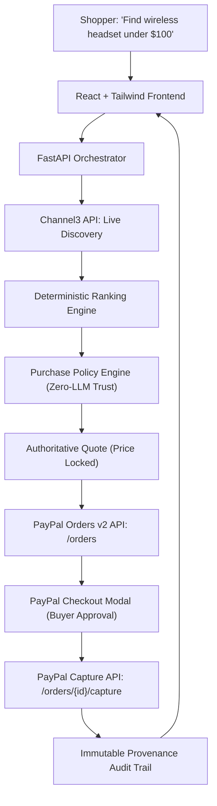

# PayPilot (paypilot-ai-commerce)

> **An AI Commerce Agent that Shops, Decides, and Pays Within Your Rules**  
> *Built for the PayPal AI Hackathon 2026*

[](https://opensource.org/licenses/MIT)
[](https://www.python.org/)
[](https://react.dev/)
[](https://developer.paypal.com/api/rest/integration/orders-api)
[](https://trychannel3.com/)

---

## 🎯 Executive Summary & Problem Statement

**The Problem:** Traditional AI shopping bots either generate passive affiliate links (boring) or attempt to execute unconstrained autonomous purchases (terrifying). LLMs hallucinate prices, overlook shipping caps, ignore fine print, and cannot be trusted with an open wallet.

**The Solution:** **PayPilot** implements **Policy-Constrained Agency**:
1. **Intelligent Discovery:** Leverages the **Channel3 API** to retrieve real-time external product candidates, live retailer offers, and verified attributes.
2. **Deterministic Guardrails:** Evaluates candidates against a non-LLM, mathematical **Purchase Policy Engine** (hard budget limits, required attributes, active catalog checks).
3. **Consent-First PayPal Checkout:** Prepares a cryptographically locked quote, creates a server-side **PayPal Sandbox Order**, and requires **explicit buyer approval** before capturing payment.
4. **Auditable Provenance:** Produces an immutable event timeline tracing every recommendation, policy check, and payment capture ID.

---

## 🏗️ Architecture



---

## 🛡️ Core Differentiator: The Purchase Policy Engine

PayPilot separates **discovery reasoning** from **financial execution**. Even if an LLM is prompt-injected or hallucinates:
* **Hard Spending Ceiling:** $\text{Price} + \text{Tax} + \text{Shipping} \le \text{Max Total}$. Rejects purchases that exceed the budget by even $\$0.01$.
* **Authoritative Server Pricing:** Item amounts are derived from the server database, never accepted from client payloads.
* **Quote Expiration:** Quotes expire after 10 minutes. Stale price changes trigger re-evaluation.
* **Consent Gate:** Autonomous checkout without human PayPal approval is blocked at the API level.

---

## 🚀 Quickstart Guide

### 1. Prerequisites
* **Python 3.12+**
* **Node.js 20+**
* (Optional) PayPal Developer Sandbox account & Channel3 API key

### 2. Backend Setup
```bash
cd backend
python -m venv venv
# On Windows:
.\venv\Scripts\activate
# On Linux/macOS:
source venv/bin/activate

pip install -r requirements.txt
cp ../.env.example .env
```

Run test suite:
```bash
pytest -v
```

Start backend development server:
```bash
uvicorn app.main:app --reload --port 8000
```
API Documentation will be live at `http://localhost:8000/docs`.

### 3. Frontend Setup
```bash
cd frontend
npm install
npm run dev
```
Open `http://localhost:5173` in your browser.

---

## 📦 Production Deployment (Render)

PayPilot includes a production blueprint `render.yaml` supporting:
* **Web Service:** FastAPI with Uvicorn (`/health` check configured).
* **Static Site:** React + Vite distribution.
* **PostgreSQL:** Managed database instance with persistent session/audit logs.

---

## 🧪 Automated Test Suite (100% Pass)
```
tests/test_api_endpoints.py::test_health_check PASSED
tests/test_api_endpoints.py::test_discovery_search PASSED
tests/test_api_endpoints.py::test_policy_evaluation_success_and_quote PASSED
tests/test_api_endpoints.py::test_policy_evaluation_budget_exceeded PASSED
tests/test_api_endpoints.py::test_end_to_end_checkout_and_capture PASSED
tests/test_policy_engine.py::test_policy_budget_pass PASSED
tests/test_policy_engine.py::test_policy_budget_exceeded PASSED
tests/test_policy_engine.py::test_policy_inactive_sku PASSED
tests/test_policy_engine.py::test_policy_required_feature_unverified PASSED
```

---

## ⚖️ Disclosure & License
* All transactions are processed strictly in **PayPal Sandbox**. No real funds are moved.
* Released under the [MIT License](LICENSE).
