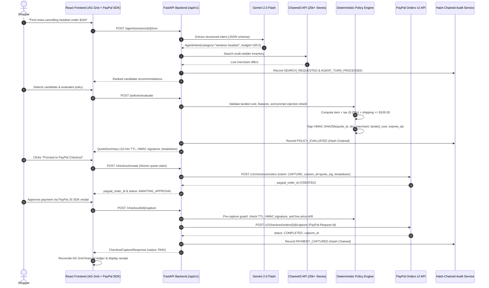

# PayPilot Architecture Documentation

## Overview
**PayPilot** is an autonomous AI commerce agent built for the **2026 PayPal AI Hackathon** that enforces deterministic financial guardrails, dual-gated human consent, and cryptographic auditability over agentic transactions.

It demonstrates **Policy-Constrained Agency**: allowing an AI to research across 25,000+ merchants, extract shopping intent, compare live catalogue prices, and assemble orders while preventing any LLM from bypassing spending rules or initiating autonomous fund movements.

---

## The 5-Stage "Separation of Powers" Pipeline

PayPilot enforces a strict separation of powers where the AI recommends, deterministic code governs, the human approves, and the ledger reconciles:

```
[1. Gemini Intent] ──> [2. Channel3 Discovery] ──> [3. Python Policy & HMAC] ──> [4. PayPal Orders v2] ──> [5. AG Studio Ledger]
(Structured JSON)      (25,000+ Store Offers)     (Landed Cost & 10m TTL)        (Explicit Buyer Consent)   (AG Grid Reconciliation)
```

1. **Stage 1: Gemini Intent Parsing (Structured JSON)**
   - Gemini (`gemini-2.0-flash`) converts natural language shopper prompts into validated `AgentIntent` schemas: category, budget ceiling, required hardware features (`must_have`), preferences, and exclusions (`avoid`).
   - Grounded prompt framing instructs the model to treat input as data, preventing indirect prompt injections. A fast deterministic regex fallback operates if Gemini is unavailable or times out.
   - The AI **cannot** approve budgets, set prices, or move funds.

2. **Stage 2: Multi-Retailer Product Discovery (Channel3 API)**
   - Channel3 is queried across 25,000+ live online retailers, returning structured product data, merchant offers, availability, live prices, and buy links.
   - High-fidelity demo-store products provide guaranteed purchasable inventory processed through the PayPal Orders v2 sandbox.
   - Dual-source ranking engine sorts by feature-match score ($F$), evidence confidence ($E$), and price-value ratio ($P$).

3. **Stage 3: Deterministic Purchase Policy Engine & Cryptographic HMAC Quote Lock**
   - **Zero LLM Trust**: Spending rules and security constraints are evaluated entirely in deterministic Python code.
   - **True Landed Cost Validation**: Calculates exact item price + estimated sales tax (8.25%) + shipping ($0 for orders >= $50, else $5.99). The policy engine enforces `landed_cost <= budget_ceiling`, preventing hidden tax/shipping budget overruns.
   - **Indirect Prompt Injection Shield**: Scans raw product metadata for adversarial patterns (`"ignore previous instructions"`, `"override budget"`, `"system prompt"`) and discards tainted offers before quote generation.
   - **Cryptographic HMAC-SHA256 Quote Binding**: Generates a 10-minute authoritative quote token binding `(quote_id, sku, merchant, landed_cost, expires_at)` using `hmac.new(secret, payload, sha256).hexdigest()`.

4. **Stage 4: Consent-First PayPal Sandbox Checkout (Orders v2)**
   - Server-side creation of PayPal Orders (`POST /v2/checkout/orders`, `intent: CAPTURE`) passing `item_total`, `tax_total`, `shipping`, and binding the quote signature into `purchase_units[0].custom_id` and `invoice_id`.
   - **Pre-Capture Re-Verification Guard**: Before funds move, PayPilot verifies:
     1. Quote has not expired (`now <= quote.expires_at`).
     2. Cryptographic HMAC signature integrity via constant-time `hmac.compare_digest`.
     3. Idempotency (order has not already been captured).
     4. Live merchant stock & price drift check: if the retailer raised prices above the locked quote, capture is blocked and the order is auto-voided.
   - **Explicit Human Consent**: Payment capture requires explicit buyer authentication through the official PayPal JS SDK (`@paypal/react-paypal-js`).

5. **Stage 5: AG Grid & AG Studio In-Memory Financial Ledger Reconciliation**
   - Interactive high-performance **AG Grid React (`ag-grid-react` v36)** grid with column pinning, sorting, multi-status badges, and real-time filtering.
   - Adheres to the **Embedded Financial Analytics Blueprint**: exports relational multi-table data models (`orders`, `transactions`, `customers`), computed KPIs (Total Invoiced, Settled Volume, Collection Rate, AOV), and serializable `AGReportState` JSON.
   - Asynchronous PayPal webhook receiver (`/api/v1/webhooks/paypal`) idempotently reconciles payment captures, order approvals, and denials.
   - **Cryptographic Hash-Chained Audit Trail**: Every session event is chained via SHA-256 (`prev_hash` -> `entry_hash`), creating an immutable provenance trail from genesis.

---

## Detailed System Sequence Flow



---

## Security Architecture & Threat Mitigations

| Threat Vector | Agentic Commerce Vulnerability | PayPilot Mitigation |
|---|---|---|
| **Autonomous Overspending** | LLM spends user funds without human approval | Dual-gated human consent: no funds move without explicit PayPal SDK authorization. |
| **Landed Cost Budget Overrun** | Item meets budget, but taxes & shipping push order over limit | True landed cost engine computes item + 8.25% tax + shipping and rejects before quote issuance. |
| **Indirect Prompt Injection** | Retailer descriptions instruct LLM to ignore budget rules | Regex & structured prompt isolation + deterministic Python policy engine discarding adversarial patterns. |
| **Quote & Price Tampering** | Buyer or adversary manipulates quoted price in transit | Cryptographic HMAC-SHA256 signature binding quote parameters; verified with `hmac.compare_digest`. |
| **Pre-Capture Price Drift** | Retailer spikes price during the 10-minute approval window | Pre-capture guardian queries live price and auto-voids order if price drifted above locked quote. |
| **Cross-Session Hijacking** | Malicious user claims another session's quote or order | Signed bearer session tokens (`sess_...`) bound to session ownership on every mutating route. |
| **Audit Log Alteration** | Attacker tampers with historical transaction events | Cryptographic SHA-256 hash chaining (`prev_hash` -> `entry_hash`) creates a verifiable audit chain. |
